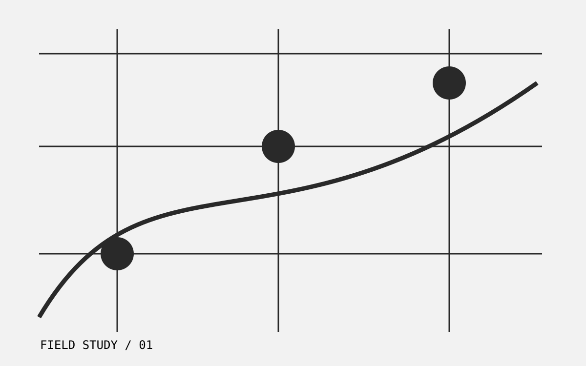

## September / A field walk

A journal entry can use the **Article** source type without requiring a separate Blog system. It participates in a chronological Index through its publication date.

A small observation raises a larger question: who defines the boundaries of a public interaction?[^field]

The field notes connect to a wider research method [@colqyVale2025].

[^field]: This journal entry is fictional and intended to demonstrate dated publishing and footnotes.
