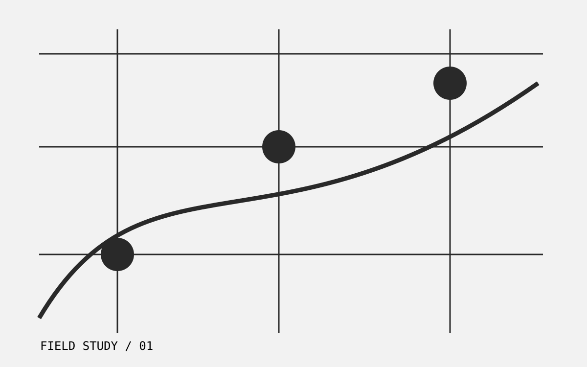

## Markdown & media reference

This page demonstrates the Markdown syntax and Colqy shortcodes supported by the current public skin. It is also an ongoing regression fixture.

## Text and inline syntax

Ordinary text, **bold**, *italic*, ***bold italic***, ~~strikethrough~~, `inline code`, and a [link to the research article](../research-note/).

Automatic URL: <https://example.org>. Escaped characters: \*not italic\* and \#not a heading.

## Heading hierarchy

### Third-level heading

#### Fourth-level heading

##### Fifth-level heading

###### Sixth-level heading

Headings should remain legible at each level and appear in an appropriate hierarchy.

## Lists and tasks

- First item
- Second item
  - Nested item
  - Another nested item
- Third item

1. First ordered item
2. Second ordered item
   1. Nested numbered item
   2. Another numbered item

- [x] Completed task
- [ ] Open task

## Line breaks and Unicode

A line with two trailing spaces.  
The following line should be a hard break within the same paragraph.

Unicode text: café, naïve, 東京, مرحبا. The theme should use fonts with adequate glyph coverage.

## Quotes and dividers

> A blockquote is visually distinct from body text.
>
> A second paragraph remains part of the quotation.
>
> > A nested quotation demonstrates indentation.

---

## Tables

| Left aligned | Centred | Right aligned |
|:--|:--:|--:|
| Observation | Prototype | 12 |
| Research | Reflection | 4 |

Tables should remain readable on narrow screens, including when horizontal scrolling is necessary.

## Code

Inline `const sample = true;` and a fenced code block:

```js
// This code is displayed, not executed.
const observations = ["field", "studio", "publication"];
console.log(observations.join(" / "));
```

Literal citation text in code should remain literal: `[@colqyVale2025]`.

## Footnotes and citations

A Markdown footnote can add explanatory context.[^demo] A scholarly citation is different: it is processed by Pandoc from the global reference library [@colqyVale2025; @colqyElian2024].

[^demo]: This is a native explanatory footnote. It is not part of the CSL bibliography.

## Markdown image



## Linked image

[](../field-atlas/)

This image is inside a link and should navigate normally instead of opening the lightbox.

## Figure shortcode



## Image and text shortcode


### Working with images

Images can be aligned **left** or **right** within the primary content region. On mobile, they follow the reading sequence.

- Observation
- Translation
- Reflection


## Gallery shortcode







## External media

Audio, video and embedded iframes are shown in [Material Protocols](../material-protocols/). The `embed` shortcode requires an HTTPS URL and a descriptive title.

## GitHub-style callouts

Colqy supports GitHub-style Markdown alerts through Hugo's native Goldmark blockquote render hook. These are part of the primary document flow, unlike the status notices configured in Sveltia.

> [!NOTE]
> An observation can be recorded as a note, with **emphasis** and a [link](https://example.org).

> [!TIP]
> Use a Timeline Index for dated journal entries. You can include `inline code`.

> [!IMPORTANT]
> Cite the underlying research when making a scholarly claim.
>
> - A nested list is valid Markdown.
> - Multiple paragraphs and lists are supported.

> [!WARNING]
> External embedded media may not load without network access.

> [!CAUTION]
> Changing citation keys can break references in other Articles or Chapters.

### Ordinary blockquote comparison

> This is a standard blockquote. It should **not** receive callout styling.


## Known limitations

- Raw HTML is not enabled in the default Goldmark configuration (`unsafe = false`).
- Mathematical notation, Mermaid and arbitrary executable JavaScript are **not** promised by this default skin.
- CSL citations require the citation-aware build. Running plain Hugo after editing references can leave cached citations stale.
- External video embeds require network access and may be restricted by the provider or browser.
